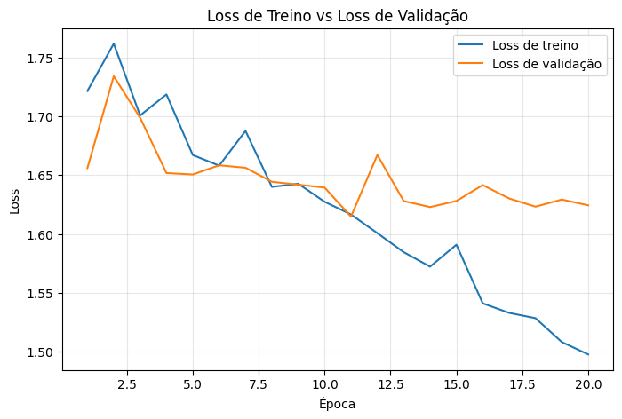
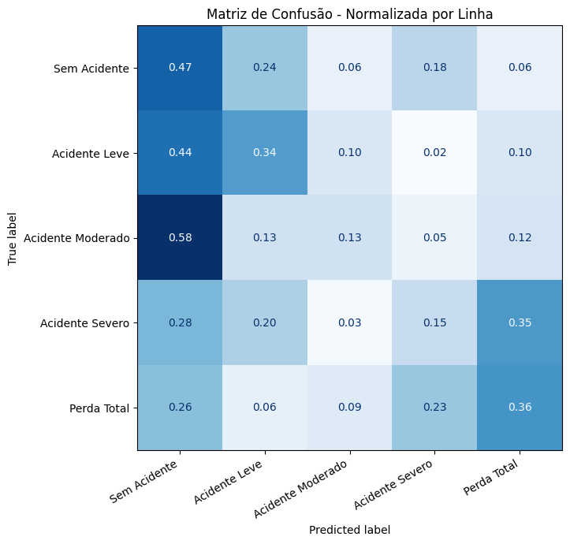
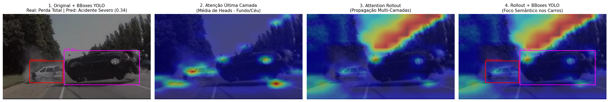

# Atividade 1 — Vision Transformer para Severidade de Acidentes

Notebook: `atividade-1-projeto-livre/vit_accident_severity_colab.ipynb`.

## Objetivo

Construir um pipeline de classificação de imagens em cinco níveis de severidade de acidentes de trânsito e comparar três modelos:

1. **ResNet-18** pré-treinada no ImageNet (baseline convolucional, *fine-tuning* completo);
2. **Vision Transformer (ViT) implementado e treinado do zero**;
3. **ViT-B/16 pré-treinado** no ImageNet-1k (*fine-tuning* completo).

Também se investiga a interpretabilidade do ViT por meio de **Attention Rollout** (Abnar & Zuidema, 2020), comparando os mapas de atenção com as *bounding boxes* anotadas.

## Dados

O **Car Accidents and Deformation Dataset (CADD)** traz anotações no formato YOLO (detecção de objetos) em cinco classes: *Sem Acidente*, *Acidente Leve*, *Acidente Moderado*, *Acidente Severo* e *Perda Total*.

**Rótulo por imagem.** Como a tarefa é de classificação, cada imagem recebe a classe **mais severa** entre os objetos anotados (`label = max(class_ids)`). Essa é uma simplificação: uma imagem com um carro intacto e outro com perda total é rotulada como *Perda Total*.

**Inspeção.** Foram encontradas 1.221 imagens válidas com rótulo; duas imagens da validação original foram descartadas por não terem arquivo de rótulo.

**Divisão com controle de vazamento.** O dataset contém cópias aumentadas das mesmas fotos (sufixos como `_flip`, `_flip30`, `_flip70`). Na divisão original do dataset, **70 grupos** de imagens apareciam simultaneamente no treino e na validação, o que caracteriza vazamento. O notebook remove esses sufixos para obter um identificador de grupo (1.016 grupos) e refaz a divisão 80/20 **por grupo**, garantindo que nenhuma foto e suas variações apareçam nos dois conjuntos.

| Classe | Treino | Validação |
|---|---:|---:|
| Sem Acidente | 48 | 17 |
| Acidente Leve | 245 | 59 |
| Acidente Moderado | 253 | 78 |
| Acidente Severo | 163 | 40 |
| Perda Total | 271 | 47 |
| **Total** | **980** | **241** |

A classe *Sem Acidente* é a menos representada. Para compensar, a função de perda usa **pesos de classe** inversamente proporcionais à frequência (de 0,72 para *Perda Total* a 4,08 para *Sem Acidente*) e **label smoothing** de 0,1.

## Método

Entrada de 224×224 com normalização do ImageNet. No treino, aplicou-se *data augmentation* com `RandomResizedCrop` (escala 0,7–1,0), espelhamento horizontal, rotação de ±15° e `ColorJitter`. Todos os modelos usam AdamW e mixed precision na GPU.

| Modelo | Inicialização | Épocas | LR | Agenda de LR |
|----------------------------|--------------|--------:|------:|----------------------|
| ResNet-18 | ImageNet | 5 | 3e-4 | Cosseno |
| ViT do zero (6 blocos, 6 cabeças, dim. 384, patch 16) | Aleatória | 20 | 3e-4 | Warmup linear (3 ép.) + cosseno |
| ViT-B/16 | ImageNet-1k | 10 | 1e-4 | Warmup linear (2 ép.) + cosseno |

O ViT do zero foi implementado explicitamente: *patch embedding* por convolução com *stride* igual ao *patch*, token `[CLS]`, *embeddings* posicionais aprendidos e blocos *pre-norm* com atenção multi-cabeça calculada como $\mathrm{softmax}(QK^\top/\sqrt{d_k})V$. Em todos os modelos, o melhor estado foi escolhido pela **macro F1 de validação**.

## Resultados

| Modelo | Melhor época | Acurácia | Macro precisão | Macro recall | Macro F1 |
|--------------------------|------:|------:|------:|------:|------:|
| ResNet-18 (ImageNet) | 3 | 0,527 | 0,539 | 0,550 | 0,518 |
| ViT do zero | 19 | 0,253 | 0,316 | 0,290 | 0,253 |
| **ViT-B/16 (ImageNet-1k)** | 8 | **0,568** | **0,578** | **0,606** | **0,576** |

Como referências mínimas: um classificador que sempre prevê a classe mais frequente da validação (*Acidente Moderado*, 78 de 241) obtém **0,324** de acurácia, e o acaso com cinco classes fica em torno de 0,20.

**F1 por classe do ViT-B/16 pré-treinado:** *Sem Acidente* 0,571; *Leve* 0,617; *Moderado* 0,496; *Severo* 0,438; *Perda Total* 0,756.

{width=70%}

{width=62%}

## Interpretabilidade: Attention Rollout

O Attention Rollout propaga as matrizes de atenção (média das cabeças, com a identidade somada para representar as conexões residuais) por todas as camadas e mede quanto cada *patch* contribui para o token `[CLS]`. A figura compara a atenção da última camada, o rollout e as *bounding boxes* reais.

**Leitura crítica.** No exemplo acima, o rollout concentra a atenção na faixa de **céu e árvores** no canto superior direito, e não nos veículos delimitados pelas caixas. Isso é coerente com o baixo desempenho do ViT do zero: o modelo não aprendeu a focar nos danos e parece usar pistas de fundo. A legenda "Foco Semântico nos Carros" usada no notebook **não** é sustentada por esse exemplo. O rollout foi calculado apenas para o ViT do zero; o ViT-B/16 do torchvision não expõe os pesos de atenção, de modo que a análise não foi repetida para o melhor modelo.

## Discussão

- **ViT do zero não aprende com ~1.000 imagens.** O ViT treinado do zero ficou **abaixo da baseline da classe majoritária** (0,253 contra 0,324). A acurácia de treino chegou a apenas 0,40 em 20 épocas, o que indica **subajuste**, e não sobreajuste. Transformers não têm os vieses indutivos das convoluções (localidade e equivariância à translação) e precisam de muito mais dados ou de pré-treinamento. A matriz de confusão mostra previsões espalhadas, com forte tendência a *Sem Acidente*, provavelmente puxada pelo maior peso dessa classe na perda.
- **Pré-treinamento é o fator decisivo.** O ViT-B/16 pré-treinado teve o melhor resultado (macro F1 0,576), seguido da ResNet-18 (0,518). Com pré-treinamento, o Transformer supera a CNN mesmo com poucos dados.
- **Sobreajuste nos modelos pré-treinados.** Na época do checkpoint (8), o ViT-B/16 tinha 0,865 de acurácia no treino contra 0,568 na validação. A lacuna de ~30 p.p. sugere que regularização adicional, congelamento parcial ou mais dados ajudariam.
- **Classes intermediárias são as mais difíceis.** *Moderado* e *Severo* têm os menores F1, o que é esperado em uma escala ordinal com fronteiras subjetivas entre níveis vizinhos.

## Limitações

1. **Seleção otimista do checkpoint.** O melhor estado de cada modelo foi escolhido pela macro F1 na **mesma validação** usada para reportar os resultados. Os números acima tendem, portanto, a ser otimistas; o correto seria separar uma validação interna para seleção ou usar um conjunto de teste independente.
2. **Uma única semente e uma única divisão.** Com 241 imagens de validação (17 de *Sem Acidente*), as métricas têm variância alta; diferenças de poucos pontos entre modelos não são conclusivas.
3. **Rótulo por agregação.** A regra "classe mais severa" ignora a presença de múltiplos veículos e transforma um problema de detecção em classificação.
4. **Agrupamento heurístico.** O controle de vazamento depende de sufixos de nome de arquivo; cópias aumentadas com outros nomes não seriam detectadas.
5. **Reprodutibilidade parcial.** O notebook usa `cudnn.benchmark = True` e `cudnn.deterministic = False`, de modo que reexecuções na GPU podem variar ligeiramente.
6. **Interpretabilidade limitada.** Apenas três exemplos de rollout, todos do modelo mais fraco.
