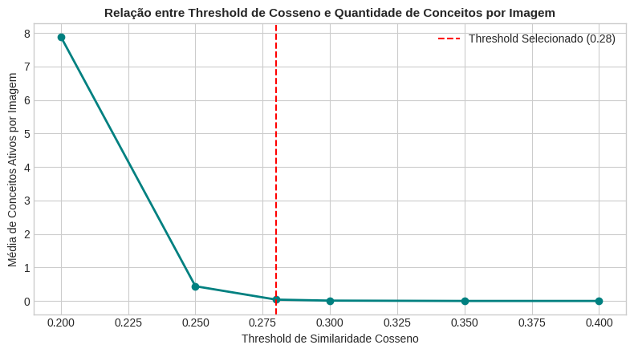
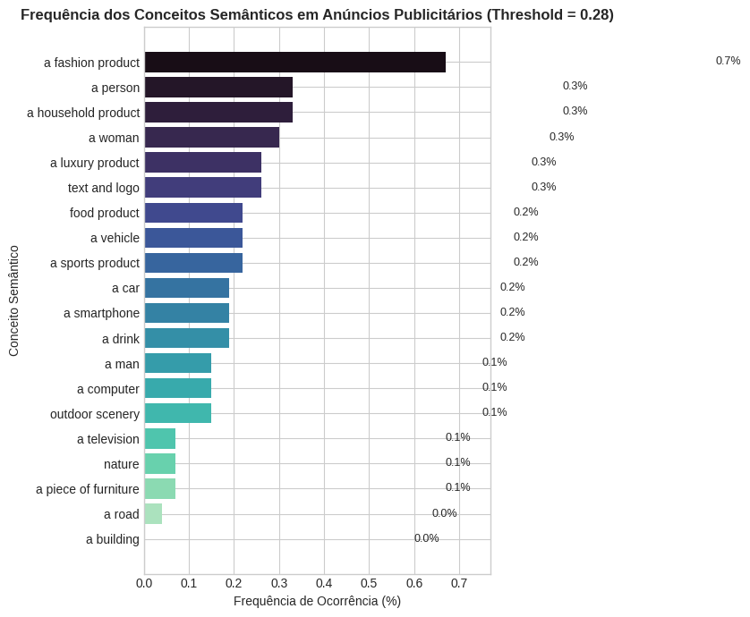
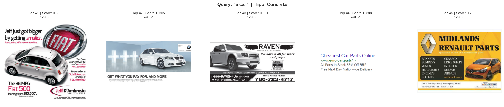
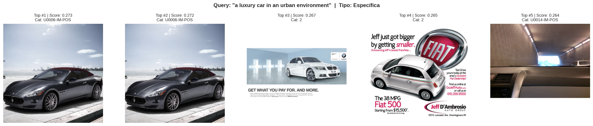
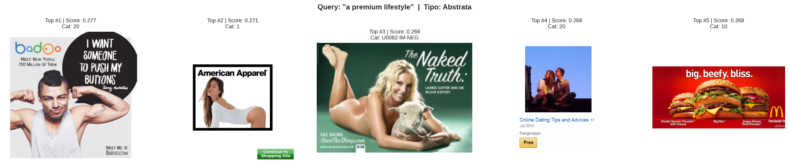

# Atividade 2 — Reconhecimento Semântico em Publicidade Visual com CLIP

Notebook: `atividade-2-clip-publicidade/clip_semantic_advertising_colab.ipynb`.

## Objetivo

Usar o **CLIP** (*Contrastive Language-Image Pre-training*, OpenAI) em regime estritamente **zero-shot** (sem treinamento, sem *fine-tuning* e sem atualização de pesos) para:

1. medir a presença de **20 conceitos semânticos** nas imagens do corpus e ordená-los por frequência;
2. implementar uma **busca semântica por texto** (*zero-shot retrieval*) e analisar oito consultas que variam de genéricas a abstratas.

## Dados

O **ADS-16 Computational Advertising Dataset** foi baixado do Kaggle (`groffo/ads16-dataset`). A varredura recursiva encontrou **2.697 imagens** distribuídas em **260 pastas**. Segundo o artigo original (Roffo e Vinciarelli, 2016), o ADS-16 reúne **300 anúncios reais** em 20 categorias de produto e, separadamente, imagens pessoais enviadas pelos 120 participantes do estudo, anotadas como positivas ou negativas. A contagem por tipo de pasta confirma essa composição:

| Tipo de pasta | Pastas | Imagens |
|------------------------------------|------:|------:|
| Anúncios (pastas `1` a `20`) | 20 | 301 |
| Imagens pessoais positivas (`U*-IM-POS`) | 120 | 1.219 |
| Imagens pessoais negativas (`U*-IM-NEG`) | 120 | 1.177 |
| **Total** | **260** | **2.697** |

Portanto, **apenas 11% do corpus são anúncios**; o restante são fotos pessoais dos participantes. O notebook trata todas as 2.697 imagens como anúncios e usa o nome da pasta apenas para exibição. Há ainda 47 arquivos repetidos: o corpus tem 2.650 conteúdos distintos (MD5).

> **Verificação independente.** A composição do corpus, as duplicatas, os percentis de similaridade e a recorrência de imagens nos top-5 não aparecem nas saídas do notebook. Eles foram calculados reexecutando o pipeline localmente (`scripts/verify_clip_activity2.py`, CLIP `ViT-B/32` em CPU). A reexecução reproduziu os mesmos top-5 das oito consultas, a mesma faixa de escores e a tabela de limiares do notebook (pequenas diferenças na 2ª casa decimal decorrem de a execução original usar precisão reduzida na GPU).

## Método

| Etapa | Implementação |
|------------|------------------------------------------|
| Modelo | CLIP `ViT-B/32`, `model.eval()` e `torch.no_grad()` em toda a inferência |
| Embeddings de imagem | Encoder visual do CLIP, 512 dimensões, normalização $L_2$ |
| Conceitos | 20 conceitos (ex.: *a car*, *a person*, *text and logo*, *a luxury product*) |
| Prompt | Template contextual `"an advertisement featuring {}"` |
| Similaridade | $S = X_{img} X_{txt}^\top$ (cosseno, pois os vetores têm norma 1), matriz 2.697 × 20 |
| Presença de conceito | Similaridade $\geq$ limiar operacional |
| Busca | Texto → embedding normalizado → produto escalar com todas as imagens → top-5 |

A similaridade de cosseno do CLIP **não é uma probabilidade**: ela mede proximidade angular no espaço multimodal, e qualquer limiar de "presença" é uma regra heurística.

## Resultados

### Escolha do limiar

| Limiar | Conceitos por imagem (média) | Imagens sem nenhum conceito |
|---:|---:|---:|
| 0,20 | 7,89 | 12,3% |
| 0,25 | 0,44 | 84,2% |
| **0,28** | **0,04** | **98,1%** |
| 0,30 | 0,01 | 99,6% |
| 0,35 | 0,00 | 100,0% |

{width=75%}

O notebook fixou o limiar em **0,28**. As similaridades imagem-conceito ocupam uma faixa estreita: 98% dos 53.940 valores (2.697 × 20) ficam entre 0,134 e 0,259 (percentis 1 e 99), e o máximo é 0,338. Por isso, entre 0,20 e 0,25 a média despenca de quase 8 para menos de 0,5 conceito por imagem.

### Ranking de conceitos (limiar 0,28)

| Posição | Conceito | Similaridade média | Imagens acima do limiar | Frequência |
|----:|--------------------|----------:|----------:|--------:|
| 1 | a fashion product | 0,1996 | 18 | 0,67% |
| 2 | a person | 0,2076 | 9 | 0,33% |
| 3 | a household product | 0,1986 | 9 | 0,33% |
| 4 | a woman | 0,1958 | 8 | 0,30% |
| 5 | a luxury product | 0,2035 | 7 | 0,26% |
| ... | ... | ... | ... | ... |
| 20 | a building | 0,1765 | 0 | 0,00% |

{width=75%}

### Busca semântica

Foram executadas oito consultas: genéricas (*a product advertisement*), concretas (*a person*, *a car*), específicas (*a person using a smartphone*, *a luxury car in an urban environment*, *a cold drink being advertised*) e abstratas (*a premium lifestyle*, *an advertisement designed to attract attention*). Os escores do top-5 ficaram entre 0,264 e 0,338.

**O que as figuras mostram** (inspeção visual das saídas):

- **Consultas concretas de objeto funcionam bem.** Em *a car*, as cinco imagens são anúncios da categoria automotiva (Fiat 500, BMW, acessórios Raven, peças Renault). Uma delas, porém, é um anúncio **apenas de texto** ("Cheapest Car Parts Online"), sem nenhum carro: o CLIP também "lê" o texto da imagem.
- **Consultas específicas funcionam parcialmente.** *A luxury car in an urban environment* recupera um Maserati (duas vezes), um BMW e o Fiat 500, mas o fundo urbano raramente está presente; a 5ª imagem é o interior de um carro em um túnel. Três dos cinco resultados (os dois Maserati e o túnel) são **fotos pessoais de participantes**, não anúncios.
- **Consultas abstratas são fracas.** *A premium lifestyle* retorna um anúncio do aplicativo de relacionamento Badoo, um da American Apparel, um anúncio de app de encontros, uma imagem de campanha da PETA (enviada por um participante, não um anúncio do corpus) e um anúncio do McDonald's. Apenas parte desses resultados pode ser associada a "estilo de vida premium".

## Discussão

- **O limiar 0,28 é restritivo demais para contar conceitos.** Com ele, 98,1% das imagens não têm nenhum conceito, e o conceito mais frequente aparece em apenas 18 de 2.697 imagens. O ranking passa a depender de poucas imagens e é instável: mudar a similaridade de poucas imagens altera as posições. Note que a ordem por **similaridade média** é diferente (*a person* teria a maior média, 0,2076). Alternativas mais robustas seriam: limiar por conceito (por exemplo, um percentil da distribuição de cada conceito), atribuição *top-k* por imagem ou comparação relativa entre conceitos (softmax sobre os 20 *prompts*).
- **Fenômeno de *hubness*.** Um pequeno conjunto de imagens domina os resultados de consultas sem relação entre si. O anúncio do **Fiat 500** aparece no top-5 de **6 das 8** consultas (inclusive *a person* e *a person using a smartphone*), o do **Badoo** em 5 das 8, e o da **Kaspersky** em 4. Curiosamente, os quatro anúncios mais recorrentes são todos o arquivo `11.png` de suas categorias (2, 20, 17 e 10), o que sugere um mesmo formato de peça. Esses "hubs" são anúncios prototípicos (produto, pessoa e texto em destaque) que ficam próximos de muitos textos no espaço do CLIP. Isso explica por que a busca parece razoável em consultas genéricas e falha em consultas que exigem detalhes.
- **Efeito do template de prompt.** A função de busca aplica o mesmo template dos conceitos às consultas. Assim, *a product advertisement* se torna "an advertisement featuring a product advertisement", e todas as consultas são puxadas na direção de "anúncio típico", o que reforça o *hubness*. Comparar a busca com e sem o template seria um experimento simples e informativo.
- **Leitura de texto (OCR implícito).** O CLIP associa palavras escritas na imagem ao conceito, como em "Car Parts", "Smartphone offers" e "Freshly Brewed Coffee" (este último aparece em *a cold drink being advertised*). Isso é útil para anúncios, mas também é uma vulnerabilidade conhecida a "ataques tipográficos".
- **Mistura de anúncios e fotos pessoais.** Como o corpus inclui as imagens pessoais dos participantes, 8 das 40 posições dos top-5 são fotos pessoais, e o ranking de conceitos descreve sobretudo essas fotos (89% do corpus), não a publicidade. Para responder à pergunta da atividade, a análise deveria se restringir às 301 imagens das pastas de anúncios.
- **Duplicatas no corpus.** Há 47 arquivos repetidos. As latas de refrigerante em *cold drink* são uma cópia exata (mesmo MD5) e ocupam duas vagas do top-5; o Maserati em *luxury car* aparece duas vezes como miniatura e original (conteúdos diferentes, mesma foto). Uma deduplicação por hash exato e perceptual antes da indexação resolveria.
- **Divergência com a tabela qualitativa do notebook.** A tabela de "comportamento observado" do notebook descreve resultados mais favoráveis do que os exibidos nas figuras (por exemplo, "precisão de 100%" para *a person*, cujo top-5 inclui o anúncio do Fiat 500 sem pessoa visível). Este relatório adota a descrição baseada nas figuras efetivamente geradas.

## Limitações

1. **Sem *ground truth*.** Não há anotação de presença de conceitos nem relevância por consulta; toda a avaliação é qualitativa. Uma rotulagem manual de uma amostra permitiria medir *precision@k*.
2. **Limiar heurístico global**, aplicado igualmente a conceitos com distribuições de similaridade diferentes.
3. **Vieses do pré-treinamento.** O CLIP herda associações culturais dos dados da web (o que é "luxo", "beleza", "atenção"), o que afeta diretamente as consultas abstratas.
4. **Embedding global.** Um único vetor por imagem não localiza objetos; composições como "pessoa *usando* smartphone" são resolvidas apenas aproximadamente.
