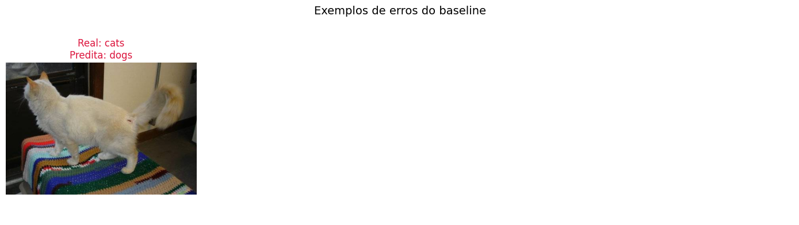

# Atividade 3 — Classificador com CNN Pré-treinada

Notebook: `atividade-3-cnn-pre-treinada/cnn_feature_extraction_colab.ipynb`.

## Objetivo

Construir um baseline de **transfer learning por extração de características**: uma ResNet-50 pré-treinada no ImageNet é usada como extratora congelada, e apenas uma nova camada linear de classificação é treinada. O baseline não usa *data augmentation*, para servir de referência limpa às propostas de melhoria.

## Dados

**Images Dataset** (Kaggle, `pavansanagapati/images-dataset`): 3.606 arquivos de imagem (`.jpg`, `.png` e `.bmp`) em 7 classes, sem nenhum arquivo corrompido.

### Remoção de duplicatas

Uma primeira execução do notebook atingiu **100% de acurácia** na validação. Um resultado perfeito exige verificação, e a inspeção dos caminhos revelou duas estruturas paralelas, `data/<classe>` e `data/data/<classe>`, com as mesmas contagens por classe. A checagem por hash MD5 confirmou que o dataset vem **inteiramente duplicado**. Ao reproduzir fora do notebook a divisão por arquivo usada inicialmente (mesma semente), verificou-se que **568 das 722 imagens de validação (78,7%) tinham uma cópia exata no treino**. Aquela acurácia media memorização, não generalização.

O notebook foi corrigido para remover as repetições **antes** da divisão:

| Etapa | Imagens |
|---|---:|
| Arquivos válidos | 3.606 |
| Removidos por duplicata exata (mesmo MD5) | −1.842 |
| Removidos por quase duplicata (dHash 16×16, distância ≤ 10 bits) | −19 |
| Removidos por rótulo ambíguo (mesmo conteúdo em classes diferentes) | 0 |
| **Imagens distintas mantidas** | **1.745** |

As 19 quase duplicatas são a mesma foto em outra resolução ou compressão; os pares foram conferidos visualmente.

### Divisão treino/validação

A divisão das imagens distintas é estratificada (80/20, semente 42). Ao final, o notebook verifica que nenhum MD5 se repete entre treino e validação e que a imagem de validação mais parecida com alguma do treino ainda está a 12 bits de distância no hash perceptual, acima do limiar de 10.

| Classe | Total | Treino | Validação |
|---|---:|---:|---:|
| bike | 360 | 288 | 72 |
| cars | 420 | 336 | 84 |
| cats | 202 | 162 | 40 |
| dogs | 201 | 161 | 40 |
| flowers | 210 | 168 | 42 |
| horses | 178 | 142 | 36 |
| human | 174 | 139 | 35 |
| **Total** | **1.745** | **1.396** | **349** |

{width=75%}

## Método

| Item | Configuração |
|------------|------------------------------------------|
| Backbone | ResNet-50, pesos `ResNet50_Weights.DEFAULT` (ImageNet), **todas as camadas congeladas** |
| Cabeça | `Linear(2048 → 7)`: 14.343 parâmetros treináveis de 23,5 milhões |
| Pré-processamento | `Resize(224)`, `CenterCrop(224)`, normalização ImageNet; sem augmentation |
| Treinamento | Entropia cruzada, Adam (lr 1e-3) apenas na cabeça, lote 32, 10 épocas |
| Seleção | Melhor acurácia de validação |

## Resultados

| Época | Loss treino | Acurácia treino | Loss validação | Acurácia validação |
|---:|---:|---:|---:|---:|
| 1 | 0,7637 | 0,8639 | 0,2347 | 0,9943 |
| 5 | 0,0463 | 0,9964 | 0,0487 | 0,9943 |
| 7 | 0,0340 | 0,9964 | 0,0375 | **0,9971** |
| 10 | 0,0200 | 0,9986 | 0,0291 | 0,9971 |

{width=90%}

O melhor checkpoint (época 7) classificou corretamente **348 das 349 imagens** de validação: **acurácia de 0,9971**, com intervalo de confiança de Wilson (95%) de **[0,984; 0,9995]**. Todas as classes têm F1 de pelo menos 0,987 (o menor é o de *cats*, com recall de 39/40). A macro F1 e as médias de precisão e recall arredondam para 1,00 com duas casas decimais.

{width=60%}

O único erro é um **gato visto de costas**, sem o rosto visível, sobre um cobertor colorido, classificado como cachorro. É uma confusão plausível: sem a face, a pelagem e a postura são as principais pistas, e elas são compartilhadas pelas duas classes.

{width=90%}

## Discussão

- **A tarefa é fácil para features do ImageNet.** As sete classes (bicicletas, carros, gatos, cães, flores, cavalos e pessoas) correspondem a conceitos amplamente representados no pré-treinamento e são linearmente separáveis no espaço de 2.048 dimensões da ResNet-50. A acurácia de validação já é de 0,994 na primeira época.
- **A correção mudou pouco o número, mas mudou o que ele significa.** A acurácia caiu de 1,000 para 0,997. A diferença é pequena porque o problema é fácil, mas o novo valor mede generalização para imagens nunca vistas, enquanto o anterior era dominado por cópias do treino. A validação ficou menor (349 contra 722 imagens), e o intervalo de confiança reflete isso.
- **Não há sinal de sobreajuste.** A loss de validação acompanha a de treino, e a lacuna de acurácia é inferior a 0,2 p.p.
- **Lição metodológica.** Deduplicar antes de dividir deve ser rotina, sobretudo quando o resultado é "bom demais".

## Propostas de melhoria

O notebook discute técnicas para experimentos posteriores, mantendo o baseline intocado:

| Técnica | Benefício esperado | Risco |
|------------------|------------------|------------------|
| Augmentation geométrica (flip horizontal, rotações e crops pequenos) | Variedade de enquadramento; menos sobreajuste | Alterar a semântica de objetos orientados |
| Augmentation de cor (`ColorJitter` conservador) | Robustez a iluminação e câmera | Apagar pistas de cor relevantes |
| Variação de escala (`RandomResizedCrop` moderado) | Robustez a distância e enquadramento | Cortar o objeto |
| Normalização ImageNet | Compatibilidade com o pré-treinamento | Já utilizada; não é augmentation |

Com um baseline de 99,7%, o ganho dessas técnicas não é mensurável nesta validação: restaria no máximo um acerto a conquistar. Para avaliá-las, seria preciso um conjunto mais difícil, por exemplo com imagens de outra fonte, objetos parcialmente visíveis ou fundos complexos.

## Limitações

1. O checkpoint foi selecionado pela acurácia na mesma validação usada para reportar o resultado. O efeito aqui é pequeno, pois as épocas 7 a 10 variam em uma única imagem, mas o protocolo correto separa uma validação interna.
2. Uma única semente e nenhum conjunto de teste independente.
3. A validação vem da mesma fonte do treino; o desempenho em imagens de outras origens não foi medido.
4. A deduplicação por hash perceptual não detecta fotos diferentes da mesma cena ou do mesmo animal.
