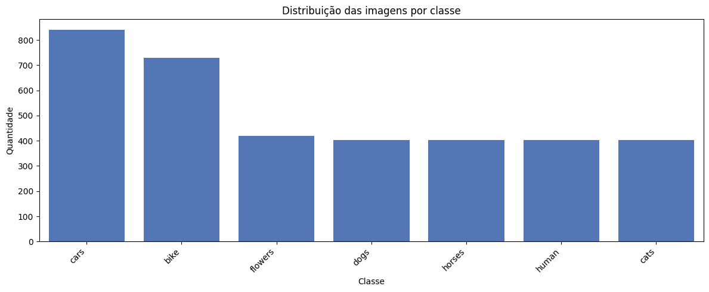
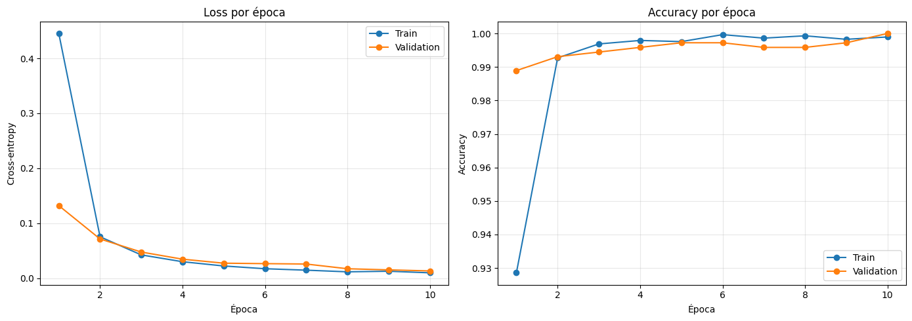
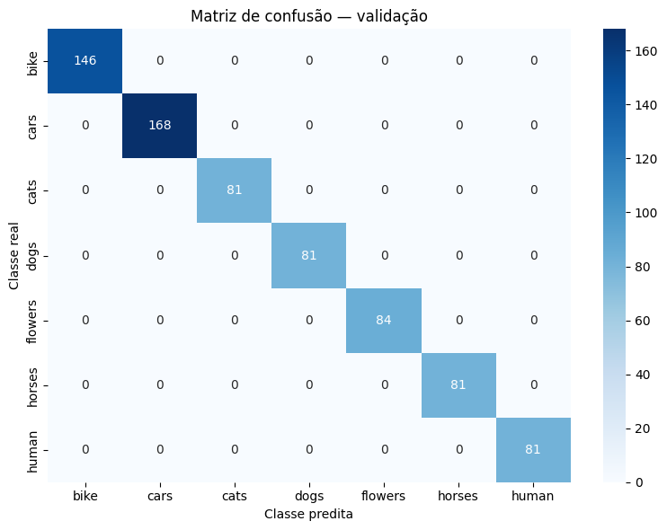

# Atividade 3 — Classificador com CNN Pré-treinada

Notebook: `atividade-3-cnn-pre-treinada/cnn_feature_extraction_colab.ipynb`.

## Objetivo

Construir um baseline de **transfer learning por extração de características**: uma ResNet-50 pré-treinada no ImageNet é usada como extratora congelada, e apenas uma nova camada linear de classificação é treinada. O baseline não usa *data augmentation*, para servir de referência limpa às propostas de melhoria.

## Dados

**Images Dataset** (Kaggle, `pavansanagapati/images-dataset`): 3.606 arquivos de imagem (`.jpg`, `.png`, `.bmp`) em 7 classes, sem nenhum arquivo corrompido.

| Classe | Total | Treino | Validação |
|---|---:|---:|---:|
| bike | 730 | 584 | 146 |
| cars | 840 | 672 | 168 |
| cats | 404 | 323 | 81 |
| dogs | 404 | 323 | 81 |
| flowers | 420 | 336 | 84 |
| horses | 404 | 323 | 81 |
| human | 404 | 323 | 81 |
| **Total** | **3.606** | **2.884** | **722** |

{width=75%}

A divisão é estratificada (80/20, semente 42).

## Método

| Item | Configuração |
|------------|------------------------------------------|
| Backbone | ResNet-50, pesos `ResNet50_Weights.DEFAULT` (ImageNet), **todas as camadas congeladas** |
| Cabeça | `Linear(2048 → 7)`: 14.343 parâmetros treináveis de 23,5 milhões |
| Pré-processamento | `Resize(224)`, `CenterCrop(224)`, normalização ImageNet; sem augmentation |
| Treinamento | Entropia cruzada, Adam (lr 1e-3) apenas na cabeça, lote 32, 10 épocas |
| Seleção | Melhor acurácia de validação |

## Resultados

| Época | Loss treino | Acurácia treino | Loss validação | Acurácia validação |
|---:|---:|---:|---:|---:|
| 1 | 0,4452 | 0,9286 | 0,1321 | 0,9889 |
| 5 | 0,0224 | 0,9976 | 0,0274 | 0,9972 |
| 10 | 0,0099 | 0,9990 | 0,0134 | **1,0000** |

{width=90%}

Na época 10, o modelo classificou corretamente **as 722 imagens de validação**: acurácia, precisão, recall e F1 iguais a 1,00 em todas as classes, sem nenhum erro a exibir.

{width=60%}

## Análise crítica: vazamento por imagens duplicadas

Um resultado perfeito exige verificação. Os caminhos listados no notebook já indicavam duas estruturas paralelas (por exemplo, `data/horses/...` e `data/data/bike/...`). Para checar, o dataset foi baixado novamente e a divisão do notebook foi reproduzida com as mesmas sementes, calculando o hash MD5 de cada arquivo:

| Verificação | Resultado |
|----------------------------------------|---------------------:|
| Pastas `data/<classe>` e `data/data/<classe>` | mesmas contagens por classe (ex.: 420 + 420 em *cars*) |
| Conteúdos distintos (MD5) entre os 3.606 arquivos | **1.764** |
| Arquivos que têm ao menos uma cópia idêntica | **3.606 (100%)** |
| Imagens de validação com cópia exata no treino | **568 de 722 (78,7%)** |
| Imagens de validação sem cópia no treino (MD5 nem hash perceptual) | 154 |

Ou seja, o dataset vem **inteiramente duplicado**. Como a divisão foi feita por arquivo, quase 79% da validação consiste em imagens que o classificador viu no treino. A acurácia de 100% sobre 722 imagens **não é uma estimativa válida de generalização**.

Ainda assim, há uma evidência útil nas saídas: como o modelo não errou nenhuma imagem de validação, também acertou as **154 imagens sem cópia no treino**. Para 154 acertos em 154, o intervalo de confiança de Wilson (95%) para a acurácia é aproximadamente **[0,976; 1,000]**. A tarefa é de fato fácil para features do ImageNet: as sete classes (carros, bicicletas, cães, gatos, cavalos, flores e pessoas) correspondem a conceitos amplamente representados no pré-treinamento e tendem a ser linearmente separáveis no espaço de 2.048 dimensões da ResNet-50. As curvas, com acurácia de validação de 0,989 já na primeira época, são coerentes com essa leitura.

**Correção recomendada:** remover duplicatas por MD5 **antes** da divisão (ou dividir por grupo de conteúdo), reexecutar o experimento e reportar a acurácia sobre as ~1.764 imagens distintas.

## Propostas de melhoria

O notebook discute técnicas para experimentos posteriores, mantendo o baseline intocado:

| Técnica | Benefício esperado | Risco |
|------------------|------------------|------------------|
| Augmentation geométrica (flip horizontal, rotações e crops pequenos) | Variedade de enquadramento; menos sobreajuste | Alterar a semântica de objetos orientados |
| Augmentation de cor (`ColorJitter` conservador) | Robustez a iluminação e câmera | Apagar pistas de cor relevantes |
| Variação de escala (`RandomResizedCrop` moderado) | Robustez a distância e enquadramento | Cortar o objeto |
| Normalização ImageNet | Compatibilidade com o pré-treinamento | Já utilizada; não é augmentation |

Diante do vazamento identificado, a prioridade é outra: **deduplicar e reavaliar**. Com um baseline já próximo de 100%, ganhos de augmentation só serão mensuráveis com um conjunto de avaliação mais difícil, por exemplo com imagens de outra fonte.

## Limitações

1. Vazamento por duplicatas, descrito acima.
2. Seleção do checkpoint pela acurácia na mesma validação usada para reportar o resultado.
3. Apenas acurácia e matriz de confusão; com classes desbalanceadas (*cars* tem o dobro de *cats*), métricas por classe e macro F1 deveriam ser padrão (aqui todas valem 1,0).
4. Uma única semente e nenhum conjunto de teste independente.
