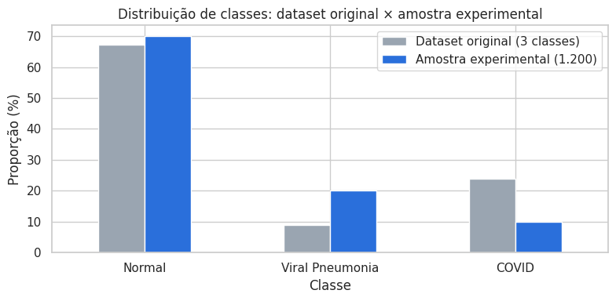
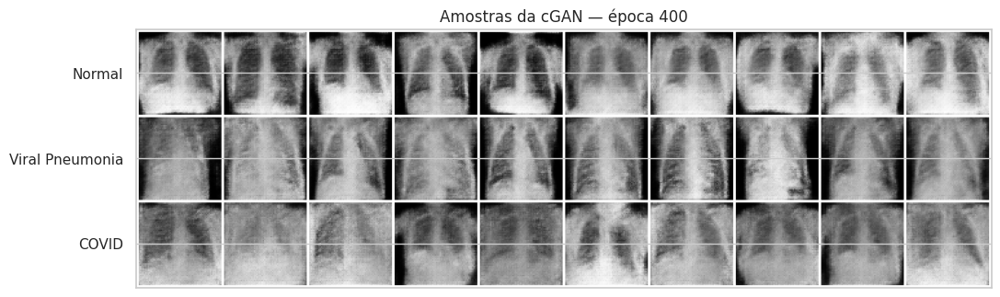
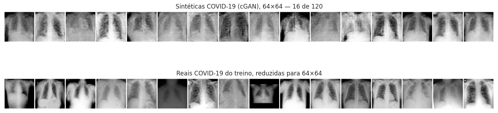
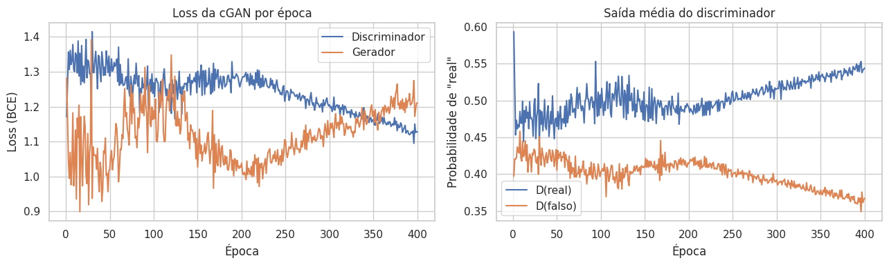
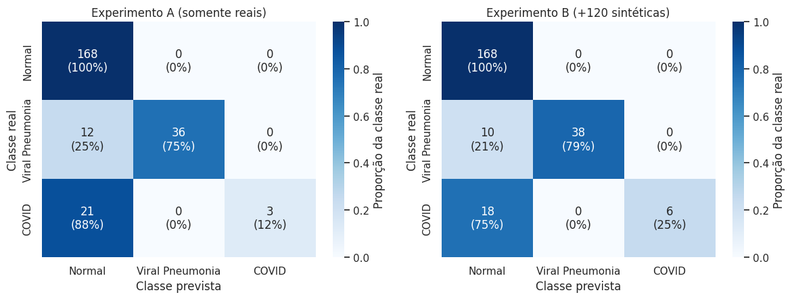
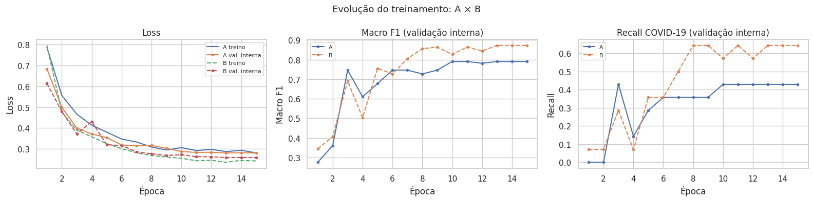

# Atividade 4 — Estudos de Caso em Deep Learning

Notebook: `atividade-4-estudos-de-caso/covid_cgan_case_study_colab.ipynb`.

## Atividade 4.1 — Detecção de COVID-19 em radiografias

### Cenário e objetivo

O enunciado descreve um classificador de radiografias de tórax com 1.200 imagens (840 *Normal*, 240 *Viral Pneumonia*, 120 *COVID-19*). Esse classificador usa uma ResNet-18 treinada do zero, SGD com taxa de aprendizado fixa de 0,01, 15 épocas, nenhum *data augmentation*, divisão 80/20 não estratificada e avaliação apenas por acurácia. Os resultados relatados no cenário foram 93% de acurácia no treino e 61% na validação, e a equipe clínica percebe que o modelo "ignora" os casos de COVID-19. Esses números pertencem ao enunciado e não foram reproduzidos aqui.

O objetivo é montar um experimento controlado com a mesma composição de classes e testar se imagens sintéticas de COVID-19, geradas por uma **GAN condicional (cGAN)**, melhoram a detecção da classe minoritária. A métrica primária é o **recall de COVID-19**, $TP/(TP+FN)$, sempre lida em conjunto com a precisão, o F1, a macro F1 e a matriz de confusão.

### Diagnóstico do cenário original

| # | Problema | Status | Consequência |
|---|---|---|---|
| 1 | Desbalanceamento (70/20/10%) | Comprovado | Prever sempre *Normal* já rende 70% de acurácia; muitos falsos negativos de COVID |
| 2 | Divisão não estratificada | Comprovado | Validação com poucos casos de COVID; recall instável |
| 3 | ResNet-18 do zero com ~960 imagens | Comprovado | Memorização, coerente com a lacuna de 32 p.p. entre treino e validação |
| 4 | Sem *data augmentation* | Comprovado | Menor robustez a posicionamento e exposição |
| 5 | Taxa de aprendizado fixa, sem ajuste | Comprovado | Convergência subótima; a última época pode não ser a melhor |
| 6 | Apenas acurácia global | Comprovado | Esconde o recall quase nulo da classe de interesse |
| 7 | Sem conjunto de teste independente | Comprovado | Estimativas otimistas |
| 8 | Vazamento entre pacientes | Risco | Métricas infladas se o mesmo paciente estiver nos dois conjuntos |
| 9 | Atalhos visuais (fonte, equipamento, marcações) | Risco, com indício nos metadados | O modelo pode aprender a origem da imagem, e não a doença |
| 10 | Sem validação externa | Comprovado | Generalização desconhecida para outros hospitais e populações |

### Dados

O **COVID-19 Radiography Database** foi baixado pela API do Kaggle sem credenciais. Considerando apenas as três classes de interesse, havia 15.153 imagens PNG de 299×299 pixels: 10.192 *Normal*, 1.345 *Viral Pneumonia* e 3.616 *COVID*. Nenhuma estava corrompida, e 54 duplicatas exatas (MD5) foram removidas antes da seleção. Os metadados **não** trazem identificador de paciente, mas revelam a **fonte** de cada imagem:

| Fonte | COVID | Normal | Viral Pneumonia |
|---|---:|---:|---:|
| `kaggle.com` | 0 | 10.192 | 1.345 |
| `bimcv.cipf.es` | 2.474 | 0 | 0 |
| Outras (GitHub, Eurorad, SIRM) | 1.142 | 0 | 0 |

**Todas** as imagens de COVID vêm de repositórios diferentes dos usados para *Normal* e *Viral Pneumonia*. Classe e origem estão, portanto, completamente confundidas, o que torna real o risco de o classificador aprender a "assinatura" da fonte (equipamento, pós-processamento, marcações) em vez de achados clínicos.

A amostra experimental (840/240/120) foi sorteada com semente fixa. A proporção 70/20/10 foi imposta pelo cenário e difere da distribuição original (67/9/24).

{width=65%}

**Divisão com controle de vazamento.** Como não há ID de paciente, a divisão por paciente não foi possível. Como mitigação, imagens quase idênticas foram agrupadas por hash perceptual (dHash 16×16, distância de Hamming ≤ 10 bits) antes da divisão. Nenhum par atingiu o limiar (a menor distância entre conjuntos foi de 12 bits), de modo que cada imagem formou seu próprio grupo. Uma primeira versão com hash 8×8 encadeou centenas de radiografias distintas em um único grupo e produziu uma validação com uma única imagem. O erro foi detectado nas saídas e corrigido, e o notebook passou a interromper a execução se os grupos ou a divisão fugirem do esperado.

| Conjunto | Normal | Viral Pneumonia | COVID | Total | Uso |
|---|---:|---:|---:|---:|---|
| Treino de ajuste | 571 | 163 | 82 | 816 | Treinar o classificador e a cGAN |
| Validação interna | 101 | 29 | 14 | 144 | Selecionar o checkpoint |
| Validação real | 168 | 48 | 24 | 240 | Apenas a avaliação final de A e B |

### Método

**Classificador (idêntico nos Experimentos A e B).** ResNet-18 pré-treinada no ImageNet com o backbone congelado (extração de características); apenas a camada final `Linear(512 → 3)` é treinada (1.539 parâmetros). Entrada de 224×224, canal cinza replicado em 3 canais, normalização do ImageNet. No treino, transformação afim moderada (rotação de ±7°, translação de 4%, escala 0,95–1,05), **sem espelhamento horizontal**, porque inverter a lateralidade cria anatomia implausível. Perda de entropia cruzada sem pesos de classe, Adam (lr 1e-3, *weight decay* 1e-4) com decaimento cosseno, lote 32, 15 épocas. O checkpoint é escolhido pela **macro F1 na validação interna**, critério fixado antes do treinamento. A mesma semente garante inicialização idêntica nos dois experimentos, o que foi conferido pela soma dos pesos iniciais da camada final.

**GAN condicional.** Arquitetura no estilo DCGAN em 64×64, treinada **somente** com o treino de ajuste (a ausência de imagens de validação é verificada por *assert*), com amostragem balanceada por classe.

| Componente | Configuração |
|---|---|
| Gerador | $z \in \mathbb{R}^{100}$ + *embedding* da classe (50) → Linear → 512×4×4 → 4 ConvT (BN + ReLU) → 1×64×64, Tanh |
| Discriminador | Imagem + mapa da classe (2 canais) → 4 Conv com normalização espectral e LeakyReLU → Linear |
| Perda | BCE com logits (não saturante), *label smoothing* de 0,9 no rótulo real |
| Otimização | Adam, lr 2e-4, $\beta = (0{,}5;\ 0{,}999)$, lote 64, 400 épocas (4.800 iterações, 9 min na T4) |

Foram geradas **120 imagens sintéticas de COVID-19**. O Experimento B usa o mesmo treino real do A, acrescido dessas imagens, o que eleva a classe COVID de 82 para 202 exemplos (21,6% do treino).

### Imagens sintéticas

| Indicador (64×64) | Sintéticas | Reais (COVID) | Razão |
|---|---:|---:|---:|
| Distância média entre pares (diversidade) | 12,78 | 16,38 | 0,78 |
| Distância mediana à imagem real mais próxima | 7,10 | 8,85 | 0,80 |
| Desvio-padrão da intensidade | 0,198 | 0,234 | — |
| Pares de sintéticas quase idênticos | 0 | — | — |

**Inspeção.** As sintéticas reproduzem a forma geral do tórax (campos pulmonares escuros, mediastino claro e bordas escuras), mas são borradas, têm textura granulada típica de convoluções transpostas e não mostram costelas nem clavículas nítidas. As sintéticas de COVID são, em geral, mais "lavadas" e difusas do que as das outras classes. Isso pode refletir as opacidades presentes nos exemplos reais, mas também pode ser apenas perda de contraste: a variância de intensidade é menor que a das reais. A diversidade é cerca de 22% menor que a das imagens reais (possível colapso parcial de modos), e não há sinal de cópia direta do treino. A partir da época ~250, a saída do discriminador para imagens reais e falsas se afasta progressivamente, indício de que ele começa a sobreajustar o pequeno conjunto real. **Nenhuma imagem sintética foi avaliada por radiologista, e aparência plausível não equivale a validade clínica.**

{width=90%}

### Resultados: Experimento A × Experimento B

Ambos os modelos foram avaliados uma única vez na validação real (240 imagens reais, 24 de COVID-19).

| Métrica | Experimento A | Experimento B | Diferença |
|---|---:|---:|---:|
| Acurácia global | 0,863 | 0,883 | +2,1 p.p. |
| Macro F1 | 0,663 | 0,736 | +7,2 p.p. |
| **Recall COVID-19** | **0,125** (3/24) | **0,250** (6/24) | **+12,5 p.p.** (+100% relativo) |
| Precisão COVID-19 | 1,000 | 1,000 | 0,0 p.p. |
| F1-score COVID-19 | 0,222 | 0,400 | +17,8 p.p. |
| Falsos negativos COVID | 21 | 18 | −3 |
| Falsos positivos COVID | 0 | 0 | 0 |
| Checkpoint (época) | 10 | 13 | — |

A diferença absoluta de recall é de **12,5 pontos percentuais**. A diferença relativa (+100%) parece grande apenas porque a base é muito baixa: corresponde a **três casos adicionais** detectados.

**Incerteza.** Com 24 casos positivos, cada caso vale 4,2 p.p. de recall. Os intervalos de Wilson (95%) se sobrepõem amplamente: A em [0,043; 0,310] e B em [0,120; 0,449]. O *bootstrap* pareado (2.000 reamostragens) dá IC95% de **[+0,0; +28,6] p.p.** para a diferença de recall e de [+0,010; +0,144] para a diferença de macro F1. O recall de B supera o de A em 95% das reamostragens.

### Discussão

1. **A geração sintética aumentou o recall de COVID-19?** Nesta execução, sim: de 0,125 para 0,250 (+12,5 p.p.), com 18 em vez de 21 falsos negativos. Na validação interna, o efeito foi semelhante (recall de 0,43 para 0,64 e macro F1 de 0,79 para 0,87).
2. **Houve perda de precisão ou aumento de falsos positivos?** Não. Os dois modelos nunca previram COVID para imagens de outras classes (precisão de 1,0). O ganho não veio de "chutar COVID" com mais frequência.
3. **A acurácia global melhorou?** Ligeiramente (+2,1 p.p.). Também melhorou o recall de *Viral Pneumonia* (de 0,750 para 0,792).
4. **Há melhor equilíbrio entre classes?** Moderadamente: a macro F1 subiu 7,2 p.p. Ainda assim, **75% dos casos de COVID continuam classificados como *Normal***, e nenhum foi confundido com *Viral Pneumonia*. O desempenho na classe de interesse permanece clinicamente inaceitável.
5. **A qualidade das sintéticas explica os resultados?** Em parte. As sintéticas aumentam o peso da classe COVID na perda, de 10% para 22% do treino. Parte do ganho pode vir apenas desse **rebalanceamento**, que pesos de classe ou reamostragem também produziriam, e não de informação visual nova. Há ainda o risco de um atalho "imagem borrada ⇒ COVID", já que as sintéticas têm 64×64 pixels e são ampliadas para 224×224. Como a validação contém apenas imagens reais, esse atalho não explica diretamente os acertos, mas pode limitar o ganho.
6. **A evidência é robusta?** Não. O intervalo de confiança da diferença de recall encosta em zero, há uma única semente e uma única divisão, não há teste externo, e a confusão entre classe e fonte dos dados impede afirmar que o modelo reconhece a doença. O resultado é um **indício favorável e preliminar**, não uma conclusão.

### Plano integrado de melhorias

**Baixo custo (próximo experimento, sem novos dados):**

1. Repetir A e B com várias sementes e com validação cruzada estratificada, reportando média, desvio e intervalos de confiança.
2. Comparar B com alternativas baratas de balanceamento: *class weights* e `WeightedRandomSampler`. Se igualarem o ganho, a cGAN não se justifica.
3. Fazer análise de limiar e calibração (curvas PR, *temperature scaling*). Com precisão de 1,0, há margem para reduzir o limiar de COVID e trocar alguns falsos positivos por menos falsos negativos.
4. Fazer *fine-tuning* parcial (descongelar a `layer4`), já que features do ImageNet não foram aprendidas em radiografias.
5. Investigar atalhos: Grad-CAM, treino com pulmões segmentados (máscaras do próprio dataset) e um classificador que tente prever a **fonte** da imagem.
6. Melhorar a cGAN: maior resolução, DiffAugment ou ADA, varredura de `N_SYNTHETIC` usando apenas a validação interna, e um controle que degrade imagens reais para 64×64.

**Exigem novos dados ou validação clínica:** divisão por paciente com identificadores reais; COVID e controles vindos **das mesmas instituições e equipamentos**; conjunto de teste independente e validação externa multicêntrica; revisão das previsões e das sintéticas por radiologistas; documentação de limitações e riscos (*model card*).

> Nenhum modelo desta atividade está apto a apoiar diagnóstico médico.

## Atividade 4.2 — Transfer learning para análise de tráfego urbano

### Cenário

Uma ResNet-50 pré-treinada no ImageNet passa por *fine-tuning* com 800 *frames* rotulados de 12 câmeras urbanas, em três classes (tráfego livre, moderado e congestionado). O modelo atinge 78% de acurácia na validação, mas falha sistematicamente à noite, sob chuva e em ângulos de câmera não vistos no treino.

### Problemas e impacto operacional

| Problema | Impacto operacional |
|---|---|
| **Poucos dados e baixa diversidade**: ~67 *frames* por câmera, provavelmente concentrados em dias claros | O modelo falha justamente nas condições críticas para a gestão do tráfego (chuva, noite, incidentes) |
| **Dependência entre *frames***: *frames* consecutivos da mesma câmera são quase idênticos; uma divisão aleatória coloca o "mesmo instante" no treino e na validação | Os 78% são otimistas e medem memorização da cena |
| **Mudança de domínio**: cada câmera tem perspectiva, lente e fundo próprios; noite (faróis, ruído) e chuva (reflexos, gotas) mudam a distribuição dos pixels | Degradação silenciosa ao instalar câmeras novas ou quando o clima muda |
| **Sem avaliação por condição operacional** | As falhas foram descobertas em operação, não na validação |
| **Classes ambíguas**: "moderado" é uma faixa contínua e depende do ângulo e da distância | Ruído de rótulo e indicadores inconsistentes entre câmeras |
| **Apenas acurácia global** | Pode esconder recall baixo de "congestionado", a classe mais relevante |
| **Sem avaliação temporal ou externa** | Comportamento desconhecido em outras semanas, estações, obras ou câmeras |
| **Sem adaptação de domínio nem monitoramento** | A deriva (câmera reposicionada, lente suja) passa despercebida |

### Medidas corretivas

1. Separar treino e validação **por câmera**, com avaliação *leave-one-camera-out*, e usar **divisão temporal** para evitar *frames* vizinhos em conjuntos diferentes.
2. Coletar dados **reais** de noite, chuva e novos ângulos, com amostragem estratificada por câmera, período e clima, e aprendizado ativo para priorizar o que rotular.
3. Definir **critérios objetivos de rótulo** (ocupação, densidade por faixa, fila em uma região fixa), com exemplos de referência, dupla anotação e medida de concordância (kappa).
4. Reportar **precisão, recall e F1 por classe, macro F1 e matriz de confusão**, com destaque para o recall de "congestionado".
5. **Avaliar por fatia**: câmera, período do dia e condição climática, com um desempenho mínimo exigido em cada fatia.
6. Usar ***data augmentation*** (brilho, gamma, ruído, desfoque, gotas e reflexos simulados) e **adaptação de domínio** (ajuste de BatchNorm ao domínio-alvo, DANN, pseudo-rótulos) quando justificadas, sempre validadas em dados reais.
7. **Monitorar após a implantação**: deriva de dados e de confiança, auditorias periódicas com rótulos humanos, comparação com sensores independentes e retreinamento versionado.

### Por que 78% de acurácia não garante desempenho confiável

A acurácia é uma **média** sobre a distribuição da validação. Se a validação compartilha câmeras, ângulos, dias e condições com o treino, ela mede a capacidade de reconhecer cenas já vistas, e não de operar em condições novas. O número também não mostra **onde** estão os 22% de erro. As falhas sistemáticas observadas indicam que os erros se concentram justamente nas fatias mais críticas (noite, chuva, câmeras novas). Sob mudança de domínio, o desempenho em uma distribuição não é evidência sobre outra: em uma noite chuvosa numa câmera nova, a acurácia real pode ser muito inferior a 78%. Confiabilidade operacional exige avaliação por câmera, por condição e ao longo do tempo, além de monitoramento contínuo.

## Limitações

1. Sem identificador de paciente, o agrupamento por hash perceptual reduz, mas não elimina, o vazamento entre pacientes.
2. A validação tem apenas 24 casos de COVID, e cada caso move o recall em 4,2 p.p.
3. Os resultados vêm de uma única semente e de uma única divisão.
4. Classe e fonte dos dados estão completamente confundidas (COVID vem de repositórios distintos de *Normal* e *Viral Pneumonia*).
5. A cGAN em 64×64 foi treinada com 82 radiografias reais de COVID, sem métrica de qualidade validada para imagens médicas e sem revisão clínica.
6. O baseline com transfer learning **não** reproduz a ResNet-18 treinada do zero do cenário; os números não são comparáveis aos 93%/61% do enunciado.
7. A amostra tem proporções artificiais (70/20/10), diferentes do dataset e de qualquer prevalência clínica.
